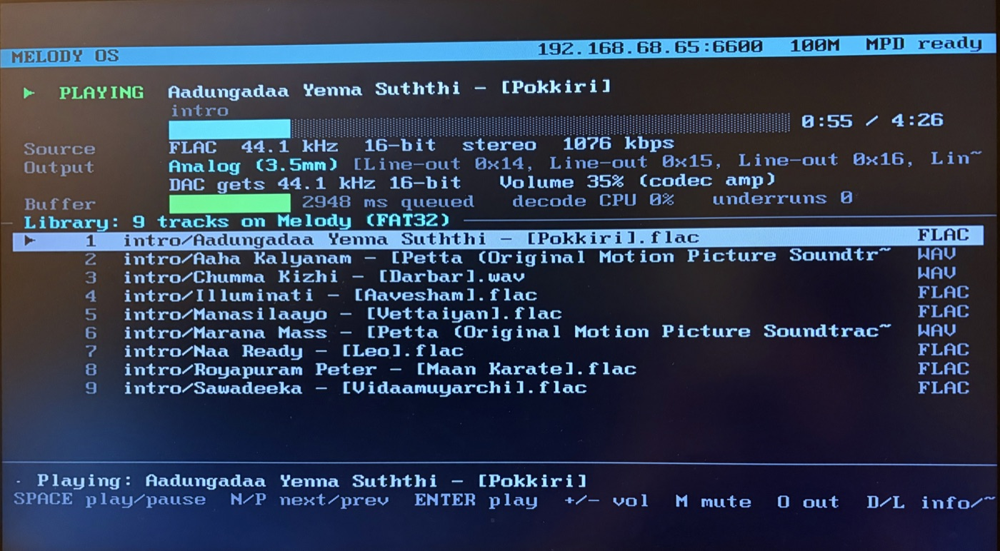
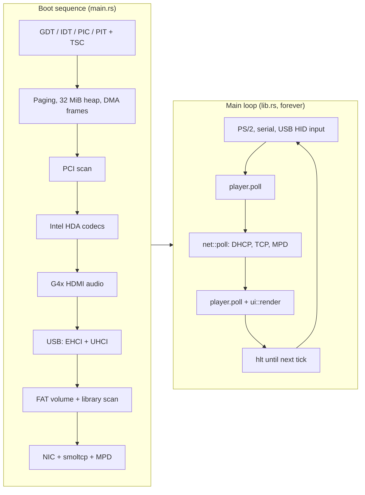
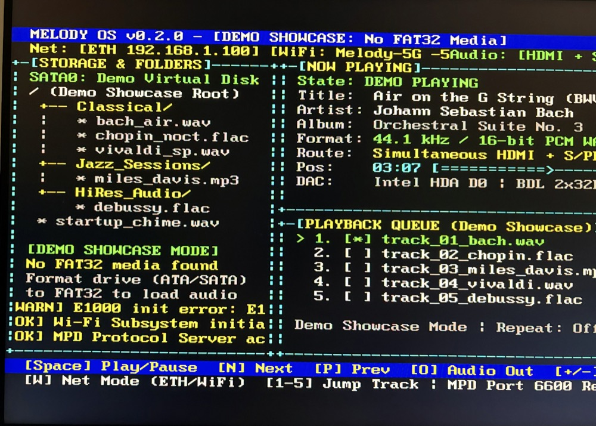

<div align="center">

# 🎵 Melody OS
### *Old PC in, jukebox out.*




</div>

---

## Overview

Melody OS is a bare-metal x86_64 kernel written in Rust that does one thing: turn an old PC
into a jukebox. It boots from a USB stick, finds music on a second FAT32 USB stick, plays it
through the on-board Intel HD Audio chip, and takes orders from the keyboard or from any MPD
client on the network.

There is no Linux and no userspace underneath. The USB host controllers, the FAT driver, the
FLAC and WAV decoders, the HDA codec walk and the Ethernet drivers are all in this repository.
It was built for, and tested on, Core 2 era desktops.

## Table of Contents

- [Hardware Support](#hardware-support)
- [Known Limitations](#known-limitations)
- [Toolchain](#toolchain)
- [Build & Run](#build--run)
- [Deploying to Real Hardware](#deploying-to-real-hardware)
- [Input Reference](#input-reference)
- [System Architecture](#system-architecture)
- [Source Tree](#source-tree)
- [License](#license)

## Hardware Support

| | Part | Details |
| :---: | :--- | :--- |
| 💾 | Music source | USB 2.0 (EHCI) or USB 1.1 (UHCI) mass storage. FAT32 or FAT16, MBR, GPT or unpartitioned, long file names, folders up to 6 deep |
| 🎼 | Formats | WAV (8/16/24/32-bit int, 32-bit float, mono/stereo/multichannel, `WAVE_FORMAT_EXTENSIBLE`), FLAC (up to 24-bit), MP3 (MPEG-1/2 Layer III) |
| 🔊 | Sound | Intel HD Audio. Analog (line-out / headphone) or digital (S/PDIF / HDMI) output, picked from the codec's pin configuration. Hardware volume through the codec amp. Native rates up to 192 kHz when the codec supports them, otherwise 2x/4x downsampling |
| 📺 | HDMI audio | Intel G4x graphics (G41/G43/G45/Q45/B43): the port is switched from DVI to HDMI mode with audio, an AVI InfoFrame is sent and the codec gets an ELD |
| 🌐 | Network | Intel PRO/1000 (8254x, 82566/82567/82562V ICH8/9/10 on-board LAN) or Realtek RTL8111/8168/8169. DHCP, ARP, answers ping |
| 🎛️ | Control | PS/2 or USB keyboard, serial console, MPD protocol on TCP port 6600 (mpc, ncmpcpp, M.A.L.P., Cantata) |
| 🖥️ | Screen | 80x25 text mode: now playing, real source/output format, buffer health and underrun count, library list, hardware info page, boot log |

## Known Limitations

| Not supported | Notes |
| :--- | :--- |
| USB 3.0 (xHCI) ports | Use the black USB 2.0 ports, not the blue ones |
| Internal SATA / IDE disks | Music must be on a USB stick |
| exFAT, NTFS | exFAT sticks are detected and reported with a "reformat as FAT32" hint |
| AAC, OGG/Vorbis, Opus | |
| Seeking | Tracks play from the start |
| Other NICs, Wi-Fi | Only the Intel and Realtek families above |
| HDMI audio on other GPUs | Only Intel G4x is programmed |
| Playlists | The MPD "queue" is the whole library in path order |

## Toolchain

| Requirement | Why |
| :--- | :--- |
| Rust nightly (pinned by `rust-toolchain.toml`) | `build-std` and a custom JSON target spec |
| `rust-src`, `llvm-tools-preview` components | Rebuilding `core`/`alloc` for `x86_64-melody.json` |
| [`bootimage`](https://github.com/rust-osdev/bootimage) | Links the kernel with `bootloader` 0.9 into a bootable disk image |
| QEMU (optional) | Running and testing without real hardware |
| `mtools` + `mkfs.fat` (optional) | Building a FAT32 music image for QEMU |

```bash
rustup component add rust-src llvm-tools-preview
cargo install bootimage
```

## Build & Run

```bash
./build.sh
# -> ~/.cache/melody-os/target/x86_64-melody/release/bootimage-melody_os.bin
```

> [!WARNING]
> Both scripts put build output in `~/.cache/melody-os/target` (override with `CARGO_TARGET_DIR`).
> The repository originally lived on an NTFS drive where cargo's build scripts can't be
> executed (`Permission denied (os error 13)`), so a plain `cargo bootimage` there fails.

**In QEMU** (Intel HDA through PulseAudio/PipeWire, an EHCI USB stick, an e1000 NIC):

```bash
./run_melody.sh --make-image ~/Music/some-folder music.img   # FAT32 image, needs mtools
./run_melody.sh music.img
mpc -p 16600 status                                          # MPD is forwarded to localhost:16600
```

The serial log goes to the terminal that launched QEMU.

**Tests** run inside QEMU through `bootimage` (exit via `isa-debug-exit`):

```bash
cd melody_os && cargo test
```

<details>
<summary>Integration tests</summary>

| Test | Covers |
| :--- | :--- |
| `basic_boot` | Kernel boots and prints |
| `heap_allocation` | Simple, large and many small heap allocations |
| `stack_overflow` | Double fault on a separate IST stack |
| `should_panic` | Panic path and QEMU exit codes |
| `pci_enum` | PCI bus scan |
| `fs_fat32` | Long names, fragmented reads and seeks, MBR sanity check on a RAM disk |
| `audio_wav` | RIFF/WAVE header parsing, skipping unknown chunks, rejecting compressed WAV |
| `mpd_server` | Greeting, status, command lists, volume, `idle` wake-ups |

</details>

## Deploying to Real Hardware

> [!CAUTION]
> `dd` overwrites the whole target device. Double-check `/dev/sdX` with `lsblk` first.

1. Write the boot image to a USB stick:
   ```bash
   sudo dd if=~/.cache/melody-os/target/x86_64-melody/release/bootimage-melody_os.bin of=/dev/sdX bs=4M conv=fsync
   ```
2. Put your music on a **second** USB stick formatted FAT32.
3. Plug both into USB 2.0 ports, set the BIOS to legacy boot from the first stick, and power on.
   The first line on screen reads `Melody OS 0.2.0 - booting`.
4. Every boot step prints its name *before* it runs. If the machine stops during boot, the last
   line on screen says where. Press <kbd>L</kbd> in the player to see the boot log again.
5. Once the player is up, the top bar shows the address your router leased over DHCP. Point an
   MPD client at it on port 6600, or `ping` it.

## Input Reference

| Key | Action |
| :--- | :--- |
| <kbd>Space</kbd> | Play / pause |
| <kbd>Enter</kbd> | Play the selected track |
| <kbd>↑</kbd> <kbd>↓</kbd>, <kbd>PgUp</kbd> <kbd>PgDn</kbd> | Move the selection |
| <kbd>N</kbd> / <kbd>P</kbd> (or <kbd>→</kbd> / <kbd>←</kbd>) | Next / previous track |
| <kbd>S</kbd> | Stop |
| <kbd>+</kbd> / <kbd>-</kbd> | Volume ±5% |
| <kbd>M</kbd> | Mute |
| <kbd>O</kbd> | Cycle output (analog / digital) |
| <kbd>D</kbd> | Hardware info page |
| <kbd>L</kbd> | Boot log (arrows / PgUp / PgDn scroll, any other key closes) |

Over the serial console the same letters work, plus <kbd>k</kbd> / <kbd>j</kbd> and ANSI arrow keys.

<details>
<summary>MPD commands handled</summary>

`status`, `currentsong`, `playlistinfo`, `playlistid`, `play`, `playid`, `pause`, `stop`,
`next`, `previous`, `setvol`, `volume`, `getvol`, `repeat`, `outputs`, `enableoutput`,
`toggleoutput`, `add`, `addid`, `lsinfo`, `listall`, `listallinfo`, `list`, `stats`,
`commands`, `tagtypes`, `idle`, `noidle`, `close`. Client housekeeping commands such as
`subscribe`, `password` and `clear` are accepted as no-ops.

```bash
mpc -h <player-ip> status
mpc -h <player-ip> play 3
mpc -h <player-ip> volume 40
```

</details>

## System Architecture

Interrupt handlers do almost nothing: the timer bumps a counter and the keyboard handler pushes
raw scancodes into a lock-free queue. Everything else runs in a single main loop, so the player
lock is never taken from an interrupt and can't deadlock against a driver.



**Audio path:** file bytes on the USB stick → streaming FAT reader → decoder → 32-bit stereo
samples → packer (format, downsampling, volume) → 512 KiB cyclic HDA DMA ring.

<details>
<summary>Intel HD Audio</summary>

Every codec is walked properly: each output pin is classified from its configuration default
(analog line-out / headphone / speaker vs. digital S/PDIF / HDMI), and a path back to a DAC is
found through the widget connection lists. Only the selected output's paths are enabled. One
output stream plays from a 512 KiB cyclic DMA ring; the driver tracks the hardware read position
(LPIB) and keeps a known amount of audio queued ahead of it. When the player has nothing to give,
silence is queued instead so stale audio never replays.

</details>

<details>
<summary>USB storage</summary>

The EHCI driver uses one asynchronous schedule with three queue heads (control, bulk OUT, bulk IN)
and a 16 KiB bounce buffer in a single physically contiguous DMA region. Transfers are synchronous
and polled with hard deadlines, so a misbehaving device can never hang boot. UHCI, the USB 1.1
companion on Intel ICH chipsets, handles keyboards and the odd full-speed flash drive. Both share
one Bulk-Only Transport / SCSI layer through the `BulkTransport` trait.

</details>

<details>
<summary>Filesystem and decoders</summary>

FAT32/FAT16 is read-only with long file names. Files are never loaded whole; the player pulls
data as it needs it. The FLAC decoder is integer-only and covers everything the reference encoder
produces: CONSTANT / VERBATIM / FIXED / LPC subframes, Rice and Rice2 residuals with escape codes,
wasted bits, and left/side, right/side and mid/side stereo. MP3 goes through `nanomp3`, a pure
Rust port of minimp3.

</details>

<details>
<summary>Networking</summary>

Both NIC drivers are polled, with descriptor rings in contiguous DMA memory. The ICH8/9/10 e1000e
parts need extra care: the software/firmware semaphore around reset, PHY power-down bits cleared,
and the management engine told not to answer ARP on the kernel's behalf. `smoltcp` provides DHCP,
ARP, ICMP echo and TCP. The IP on screen is only ever the address DHCP actually leased.

</details>

## Source Tree

```
melody-os/
├── build.sh               release boot image -> ~/.cache/melody-os/target
├── run_melody.sh          boot in QEMU (HDA, USB stick, e1000) / make a FAT32 music image
├── docs/                  README screenshots
└── melody_os/
    ├── x86_64-melody.json custom target (soft-float, no red zone, rust-lld)
    ├── tests/             QEMU integration tests
    └── src/
        ├── main.rs        boot sequence, one status line per step
        ├── lib.rs         init + the main loop (input, audio, network, screen)
        ├── interrupts.rs  IDT, PIC, PIT, TSC timing
        ├── gdt.rs         GDT + double-fault IST stack
        ├── memory.rs      paging, frame allocator, contiguous DMA memory
        ├── allocator.rs   32 MiB kernel heap
        ├── pci.rs         PCI enumeration
        ├── gpu.rs         Intel G4x HDMI audio enable
        ├── usb/           EHCI + UHCI host controllers, mass storage (BOT/SCSI)
        ├── fs.rs          FAT32/FAT16, library scan, streaming file reader
        ├── audio/         HDA driver, player, WAV/FLAC/MP3 decoders
        ├── net/           e1000 + RTL8168 drivers, smoltcp glue, MPD protocol
        ├── keyboard.rs    PS/2, USB HID and serial input -> player keys
        ├── ui.rs          text-mode interface
        ├── vga_buffer.rs  boot console + raw cell access
        └── serial.rs      16550 UART logging
```

<details>
<summary>Early prototype</summary>



An early v0.2 demo-mode screen from development. It is a UI mock-up: the Wi-Fi, SATA and
simultaneous HDMI + S/PDIF features it shows were never part of the shipped kernel.

</details>

## License

MIT License. See [LICENSE](LICENSE).

<div align="center">

*"I wrote a USB stack to avoid opening Spotify."*

</div>
